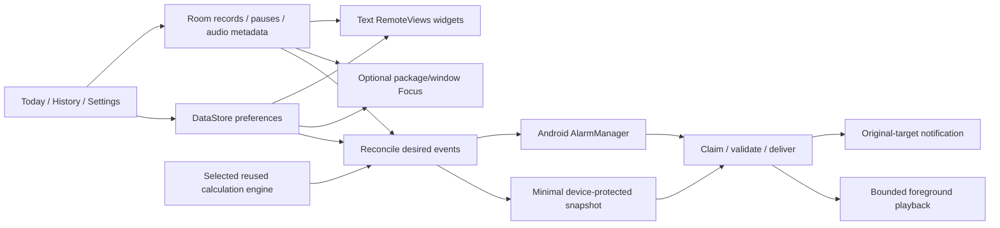

# Architecture

The app is native Kotlin/Compose on API26–37, with four modules and constructor
injection through a small composition root. It has no runtime backend, account,
network permission, analytics, billing, Rust layer or application-level KMP build.

| Module | Responsibility |
| --- | --- |
| app | Compose UI, Room/DataStore, Android delivery/audio/Focus/location/sensors/widgets |
| core | Android-free calculation adapters, dated schedules, tracking/streak/insight/Focus rules |
| praytimes | Pinned upstream JVM sources and documented unwrapped-hour adaptation |
| benchmark | Isolated Macrobenchmark journeys, synthetic history, real profile generation |

## Calculations and identity

Both adapters implement `PrayerCalculator`; only the selected profile engine runs.
Adhan is consumed as its JVM variant. PrayTimes retains its upstream algorithms;
there is no new astronomy. The service date is the requested Gregorian date at the
selected location/zone. Dhuhr must fall on that civil date. Date-line alignment,
unwrapped UTC hours and minute rounding are validated before UI or alarms consume
instants, including Isha after midnight. A single noon offset is not applied blindly
to every event across a DST transition.

Invalid/absent/unordered events return structured unavailable results. Polar search
uses the attributed established nearest-valid-latitude policy only after explicit
confirmation, discloses effective versus actual coordinates, and supports manual
reference/disabled modes. Settings/location changes invalidate old confirmation as
documented in POLAR.md. Qibla always uses actual coordinates. Regional presets are
suggestions to compare, never automatic inferences about religious practice.

The unadjusted Umm al-Qura chronology determines the explicit Ramadan Isha interval;
the independent Hijri display correction does not change calculations. Turkey is
labeled an approximation. Frozen upstream/seasonal/provider fixtures and observed
differences are documented; they do not establish agreement with every authority.
Civil conversion uses the device's `java.time` IANA rules. The bundled city/border
lookup does not replace the operating system's timezone-rule database.

## Local data and explicit records

Room schema v1 is exported under `app/schemas/`. Atomic DAO changes preserve the
original creation instant and originating zone. `PrayerKey(serviceDate, prayer)`
identifies records and every action; late notification taps never retarget today.
A transactional snapshot and invalidation Flow synchronize UI, reconciliation and
Focus. DataStore contains versioned preferences with migration from foundation setup.
Storage errors surface for retry rather than silently deleting private history.

Only an explicit action creates ON_TIME, MADE_UP, MISSED or EXCUSED. Missing remains
unrecorded. Pause suppresses targets without overwriting existing records. Excuses
pause verified continuity; unknown history interrupts verification without becoming
missed; make-ups do not restore an on-time streak. Percentages show recording coverage.

Audio is copied from the system picker into bounded private storage after actual
decoder validation. Removing audio resets affected sound choices and verifies file
deletion. Full reset first disables integrations, then clears Room/private audio and
preferences/caches. A file failure remains visible with a retry path. Export/recovery
is deferred, so uninstall/storage clearing cannot be presented as an ordinary update.

## Android lifecycle and privacy

`SalahApplication` creates credential storage lazily and starts Room integrations only
after unlock. Device-protected storage contains future event identity/time/zone,
minimal sound/challenge/token/claim and language/appearance, never coordinates,
records or pause dates. Playback before unlock uses bundled audio. Both storage
domains are excluded from backup/transfer.

The reconciler is idempotent, keeps unchanged event tokens, installs seven days of
future events and drops stale delivery. Exact primary alarms, user-enabled Fajr alarm
clocks and best-effort extras have distinct readiness. Maintenance is inexact and only
exists while enabled future alerts exist. Foreground playback is finite, owns audio
focus, respects normal ringer/DND state, prioritizes Fajr and never logs completion.
See ANDROID_ALERTS.md for contracts and external reliability limits.

Focus receives package/window metadata only, has no screen/key/gesture/screenshot
capabilities, excludes essential packages and uses a nonfocusable overlay. A weak
reference to the app's own focused window defeats delayed external window events
without inspecting another app. Emergency bypass releases immediately, persists when
possible and writes no record; normal expiry still applies.

Location requests are bounded and foreground-only; manual mode makes none. Automatic
refresh stops with visibility and zone changes require confirmation. Qibla sensors
are active only on the visible screen, with declination/rotation correction and a
numerical fallback. Widgets carry text, use native host countdowns and event-boundary
updates, and expose no completion action. Daily rows scroll at large fonts; API31+
uses direct collection items and Android8–11 uses a local RemoteViews adapter.

## Delivery and evidence

Debug fixtures and shell probes are absent from QA/release. The profile generator
and optimized benchmark target share only an isolated `.benchmark` ID, shell-protected
synthetic seed and shell profiling; production does not contain those components.
Generated profiles and raw emulator evidence are committed with provenance.

Pinned tools/dependencies/actions, locks, verification and merged-manifest/license/
native-alignment/budget checks are enforced in CI. Two independent clean workers
compare unsigned production APK bytes. Dedicated QA signing is separate and stable;
the signer checks out no repository code and fork PRs receive no signing secrets.
No ordinary workflow creates a production signature, merges or publishes a store build.

PROGRESS.md is the evidence authority. Compilation, automated emulator execution,
visual inspection and physical acceptance remain distinct. Arabic review, physical
S23/mid-range/overnight/audio/sensor/TalkBack/power testing and release/signing/store
review are external gates, not reasons to leave independent source work unfinished.
