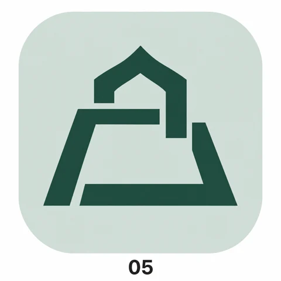

# Launcher icon

Salman approved Option 05 on 26 November 2026. The project originally generated
the concept with its image tool. The selected proof is reproduced below for
design review. The supplied full-resolution PNG has SHA-256
`28f1b85dbc9e0faca405f6508d042f0ab430622a7c01a02ae5590790300fd6d0`.
The production redraw is original project artwork under GPL-3.0-or-later.

The [editable Android vector](../../app/src/main/res/drawable/ic_launcher_foreground.xml)
uses deep green `#244A41` over a separate sage layer `#D9E3DC`. Three paths form
the uneven pointed arch, the sloped edge and inner band, and the return around
the base. The gaps have a little extra clearance at small sizes. The mark
occupies approximately 56 × 49 dp of the 108 dp viewport.

The API 26 adaptive icon supplies the color layers. The API 33 resource points
its monochrome layer at the same silhouette so launcher tints preserve the gaps.
The application icon supplies the default system splash icon. The app's
notification glyph is a separate white vector. The manifest's application icon
also supplies circular launchers. [Android adaptive icon guidance](https://developer.android.com/develop/ui/compose/system/icon_design_adaptive) ·
[Android splash screen guidance](https://developer.android.com/develop/ui/views/launch/splash-screen)

The Android fixture loads the launcher entry from the installed package and draws
its actual vector at 48 pixels. It checks that the three parts stay disconnected
and that circle, rounded-square and squircle masks leave the mark intact. The
preview sheet pairs 144-pixel detail with 48-pixel samples, including Android's
emulator mask and light and dark tint simulations using the API 33+ monochrome
layer. Samsung launcher and themed-icon appearance require physical review.
